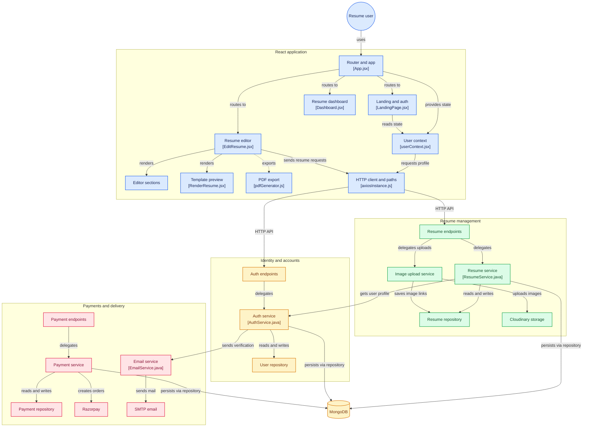

# Resume Builder

A full-stack resume creation platform that helps users build, customize, preview, and share professional resumes. The application combines a React-based editor with a Spring Boot REST API, MongoDB persistence, cloud image storage, email delivery, and Razorpay payment integration.

**Live demo:** https://resume-builder-pi-nine-78.vercel.app/

---

## Contents

- [Overview](#overview)
- [Features](#features)
- [Technology Stack](#technology-stack)
- [Application Architecture](#application-architecture)
- [Resume Data Model](#resume-data-model)
- [Project Structure](#project-structure)
- [API Reference](#api-reference)
- [Getting Started](#getting-started)
- [Environment Configuration](#environment-configuration)
- [Running with Docker](#running-with-docker)
- [Build and Quality Checks](#build-and-quality-checks)
- [Deployment Notes](#deployment)
- [Security Notes](#security-notes)

## Overview

Resume Builder provides a guided workflow for creating a resume from structured information. Users can register and verify their email, create and manage multiple resumes, fill in career and personal details through dedicated editor sections, select a visual template and color theme, and export or share the finished document.

The frontend is a single-page application built with React and Vite. The backend exposes REST endpoints using Spring Boot and stores user, resume, and payment records in MongoDB. Supporting services handle image uploads, transactional email, and premium-plan payments.

## Features

### Account and authentication
- User registration and login.
- Email verification, including the option to resend a verification email.
- Stateless authentication using JWT bearer tokens.
- Password hashing with BCrypt.
- Authenticated profile retrieval.

### Resume creation and editing
- Create, view, update, and delete resumes.
- Dashboard for accessing saved resumes.
- Guided editor with dedicated sections for:
  - Profile and professional summary
  - Contact information and social links
  - Work experience
  - Education
  - Skills
  - Projects
  - Certifications
  - Languages
  - Interests
- Save resume information to the backend and retrieve it for later editing.

### Templates and customization
- Three resume templates.
- Template selection and color-palette customization.
- Live resume rendering while editing.
- One template is available as a free option; the other two are marked as premium in the frontend template data.

### Images and document sharing
- Upload profile images and resume thumbnails to Cloudinary.
- Generate A4 PDF documents from the rendered resume using `html2canvas` and `jsPDF`.
- Print resumes.
- Email a generated PDF as an attachment through the backend email service.

### Premium payments
- Create premium-plan payment orders through the backend.
- Complete checkout using Razorpay.
- Verify payment signatures on the backend.
- View payment history and retrieve order details.

## Technology Stack

| Layer | Technologies |
|---|---|
| Frontend | React 19, Vite 6, JavaScript |
| Styling | Tailwind CSS 4 |
| Routing and HTTP | React Router 7, Axios |
| Client state | React Context API |
| PDF and printing | html2canvas, jsPDF, react-to-print |
| UI utilities | lucide-react, react-icons, react-hot-toast, moment |
| Backend | Java 21, Spring Boot 3.5.6, Maven |
| API | Spring Web |
| Security | Spring Security, JWT (JJWT), BCrypt |
| Persistence | Spring Data MongoDB, MongoDB |
| Validation and utilities | Spring Validation, Lombok, Spring Boot Actuator |
| Image storage | Cloudinary |
| Email | Spring Mail with Brevo SMTP |
| Payments | Razorpay Java SDK |

## Application Architecture

The diagram below maps the main frontend components to the Spring Boot API layers and the external services used for persistence, image storage, email delivery, and payments.



## Resume Data Model

A resume record stores its owner, title, selected template and color palette, and the information used to render the document. The data includes profile details, contact details, work experience, education, skills, projects, certifications, languages, and interests. Resume and payment records also include creation/update timestamps.

## Project Structure

```text
resume-builder-app/
├── resume-builder/                  # React + Vite frontend
│   ├── public/
│   ├── src/
│   │   ├── assets/                  # Images and template previews
│   │   ├── components/
│   │   │   ├── Cards/
│   │   │   ├── Inputs/
│   │   │   ├── layouts/
│   │   │   ├── ResumeSections/
│   │   │   └── ResumeTemplates/
│   │   ├── context/                 # User context
│   │   ├── pages/
│   │   │   ├── Auth/
│   │   │   ├── Home/
│   │   │   └── ResumeUpdate/
│   │   ├── services/                # Payment client service
│   │   └── utils/                   # API, Axios, PDF and upload helpers
│   ├── package.json
│   └── vite.config.js
│
└── resumebuilderapi/                # Spring Boot backend
    ├── src/main/java/in/shantanutripathi/resumebuilderapi/
    │   ├── config/
    │   ├── controller/
    │   ├── document/
    │   ├── dto/
    │   ├── exception/
    │   ├── repository/
    │   ├── security/
    │   ├── service/
    │   └── util/
    ├── src/main/resources/
    │   └── application.properties
    ├── Dockerfile
    └── pom.xml
```

## API Reference

All endpoints are served by the Spring Boot backend. Unless noted as public, endpoints require a valid JWT bearer token.

| Area | Method | Endpoint | Purpose |
|---|---|---|---|
| Authentication | `POST` | `/api/auth/register` | Register a user |
| Authentication | `POST` | `/api/auth/login` | Authenticate and obtain a token |
| Authentication | `GET` | `/api/auth/verify-email?token={token}` | Verify an email address |
| Authentication | `POST` | `/api/auth/resend-verification` | Resend the verification email |
| Authentication | `GET` | `/api/auth/profile` | Get the authenticated user's profile |
| Authentication | `POST` | `/api/auth/upload-image` | Upload a profile image |
| Resumes | `POST` | `/api/resumes` | Create a resume |
| Resumes | `GET` | `/api/resumes` | List the authenticated user's resumes |
| Resumes | `GET` | `/api/resumes/{id}` | Get a resume |
| Resumes | `PUT` | `/api/resumes/{id}` | Update a resume |
| Resumes | `DELETE` | `/api/resumes/{id}` | Delete a resume |
| Resumes | `PUT` | `/api/resumes/{id}/upload-images` | Upload resume thumbnail/profile images |
| Templates | `GET` | `/api/templates` | Retrieve available templates |
| Payments | `POST` | `/api/payment/create-order` | Create a premium payment order |
| Payments | `POST` | `/api/payment/verify` | Verify a Razorpay payment |
| Payments | `GET` | `/api/payment/history` | Get the user's payment history |
| Payments | `GET` | `/api/payment/order/{orderId}` | Get payment order details |
| Email | `POST` | `/api/email/send-resume` | Email a resume PDF attachment |
| Health | `GET` | `/actuator/health` | Check backend health |

**Request details**
- Protected requests use the `Authorization: Bearer <token>` header.
- The image upload and email endpoints use `multipart/form-data`.
- The email endpoint expects `recipientEmail`, `subject`, `message`, and `pdfFile` parts.
- Payment verification expects `razorpay_order_id`, `razorpay_payment_id`, and `razorpay_signature`.

## Getting Started

### Prerequisites

- Java 21
- Node.js and npm
- MongoDB locally or a MongoDB Atlas connection string
- Cloudinary account for image uploads
- Brevo SMTP credentials for email delivery
- Razorpay account and API keys for payment integration

### 1. Get the project

Clone the repository and open the project root:

```bash
git clone https://github.com/itzz-shantanu/resume-builder.git
cd resume-builder
```

The repository contains both the frontend (`resume-builder/`) and backend (`resumebuilderapi/`) applications.

### 2. Configure and run the backend

Open a terminal in the backend directory:

```bash
cd resumebuilderapi
```

Set the backend environment variables described in [Environment Configuration](#environment-configuration), then start the API:

**Windows**
```powershell
.\mvnw.cmd spring-boot:run
```

**macOS / Linux**
```bash
./mvnw spring-boot:run
```

By default, the API runs at `http://localhost:8080`. Verify it using:

```text
http://localhost:8080/actuator/health
```

### 3. Configure and run the frontend

Open another terminal from the repository root:

```bash
cd resume-builder
npm install
```

Create a `.env.local` file in the frontend directory:

```env
VITE_API_BASE_URL=http://localhost:8080
VITE_RAZORPAY_KEY_ID=your_razorpay_key_id
```

Start the Vite development server:

```bash
npm run dev
```

The frontend is available at `http://localhost:5173`.

## Environment Configuration

Configure secrets in your local environment or deployment provider. Do not commit real credentials.

### Backend variables

The backend reads the following variables from the environment:

| Variable | Purpose |
|---|---|
| `MONGODB_URI` | MongoDB connection string. Defaults to a local `resumebuilder_v2` database. |
| `BREVO_SMTP_LOGIN` | Brevo SMTP username/login |
| `BREVO_PASSWORD` | Brevo SMTP password or SMTP key |
| `BREVO_SENDER_EMAIL` | Sender email address configured in Brevo |
| `MAIL_PORT` | SMTP port. Defaults to `587`. |
| `APP_BASE_URL` | Application base URL used by the backend. Defaults to `http://localhost:8080`. |
| `CLOUDINARY_CLOUD_NAME` | Cloudinary cloud name |
| `CLOUDINARY_API_KEY` | Cloudinary API key |
| `CLOUDINARY_APISECRET` | Cloudinary API secret |
| `JWT_SECRET` | Secret used to sign JWTs |
| `RAZORPAY_KEY` | Razorpay key ID |
| `RAZORPAY_SECRET` | Razorpay key secret |
| `CORS_ALLOWED_ORIGINS` | Comma-separated allowed frontend origins. Defaults to `http://localhost:5173`. |
| `PORT` | Backend server port. Defaults to `8080`. |

### Frontend variables

| Variable | Purpose |
|---|---|
| `VITE_API_BASE_URL` | Backend base URL. Defaults to `http://localhost:8080`. |
| `VITE_RAZORPAY_KEY_ID` | Public Razorpay key ID used by the checkout client. |

Restart the Vite server after changing frontend environment variables.

## Running with Docker

The backend includes a multi-stage Dockerfile that builds the application with Java 21 and runs the packaged JAR on a Java 21 runtime image.

From the backend directory:

```bash
docker build -t resume-builder-api .
docker run --rm -p 8080:8080 \
  -e MONGODB_URI="your_mongodb_uri" \
  -e JWT_SECRET="your_jwt_secret" \
  -e BREVO_SMTP_LOGIN="your_brevo_login" \
  -e BREVO_PASSWORD="your_brevo_password" \
  -e BREVO_SENDER_EMAIL="your_sender_email" \
  -e CLOUDINARY_CLOUD_NAME="your_cloud_name" \
  -e CLOUDINARY_API_KEY="your_cloudinary_key" \
  -e CLOUDINARY_APISECRET="your_cloudinary_secret" \
  -e RAZORPAY_KEY="your_razorpay_key" \
  -e RAZORPAY_SECRET="your_razorpay_secret" \
  -e CORS_ALLOWED_ORIGINS="http://localhost:5173" \
  resume-builder-api
```

Provide any additional deployment-specific values, such as `APP_BASE_URL` and `PORT`, as needed.

## Build and Quality Checks

### Frontend

```bash
npm run build
npm run lint
```

### Backend

```bash
./mvnw clean package
```

On Windows, use `mvnw.cmd` instead of `./mvnw`.

## Deployment

The frontend is configured for Vercel-style SPA routing through `vercel.json`. The backend includes a Dockerfile suitable for container-based deployment. When deploying:

- Set the frontend `VITE_API_BASE_URL` to the deployed backend URL.
- Set `VITE_RAZORPAY_KEY_ID` to the appropriate Razorpay key ID.
- Set all backend environment variables in the hosting provider's secret/environment configuration.
- Set `CORS_ALLOWED_ORIGINS` to the exact deployed frontend origin.
- Use a managed MongoDB deployment such as MongoDB Atlas.
- Ensure the backend's `APP_BASE_URL` and email verification links use the correct deployed application/API URL.

## Security Notes

- Keep JWT, MongoDB, Cloudinary, Brevo, and Razorpay secrets out of source control.
- Use environment variables or a secret manager for credentials.
- Use HTTPS for deployed frontend and backend services.
- Restrict CORS to trusted frontend origins.
- Use Razorpay's server-side payment signature verification; never trust a client-side payment success state alone.
- Avoid sharing `.env` or `.env.local` files when publishing the project.

---

<p align="center">
  Built with React, Spring Boot, and MongoDB.
</p>
